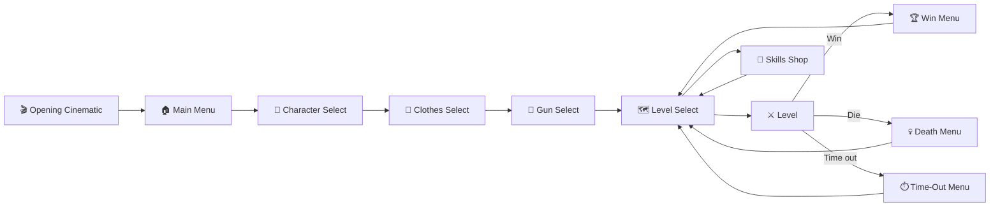
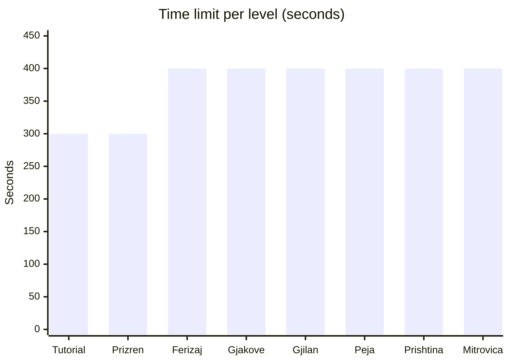
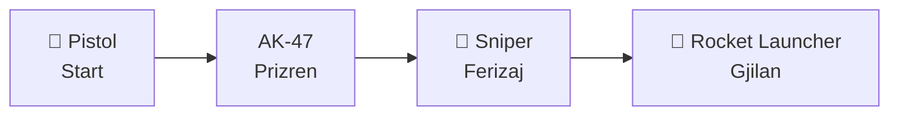
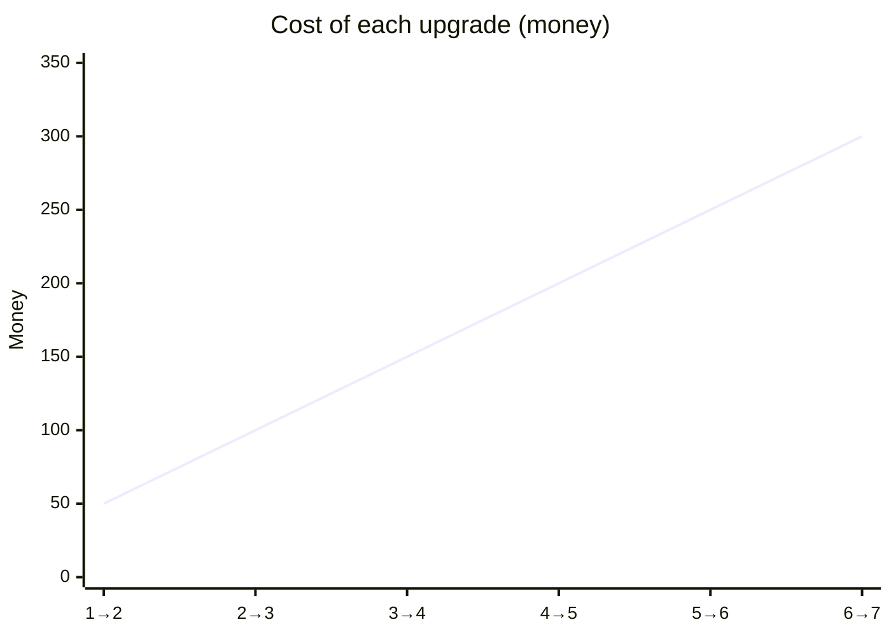
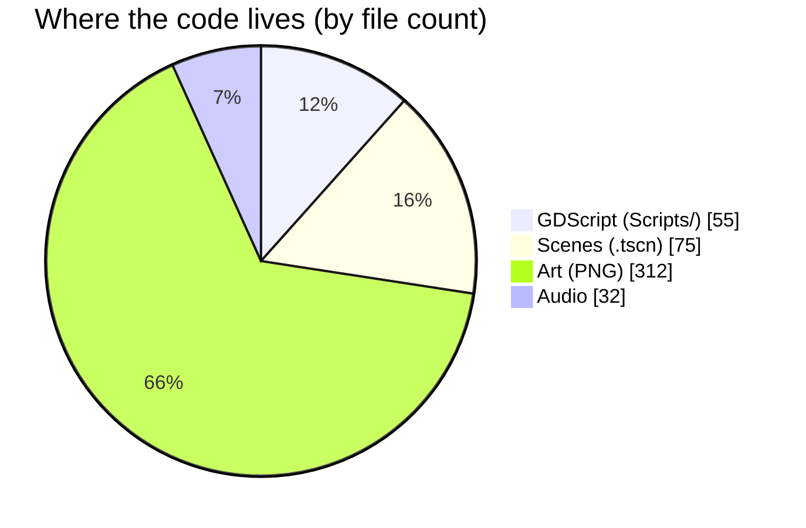
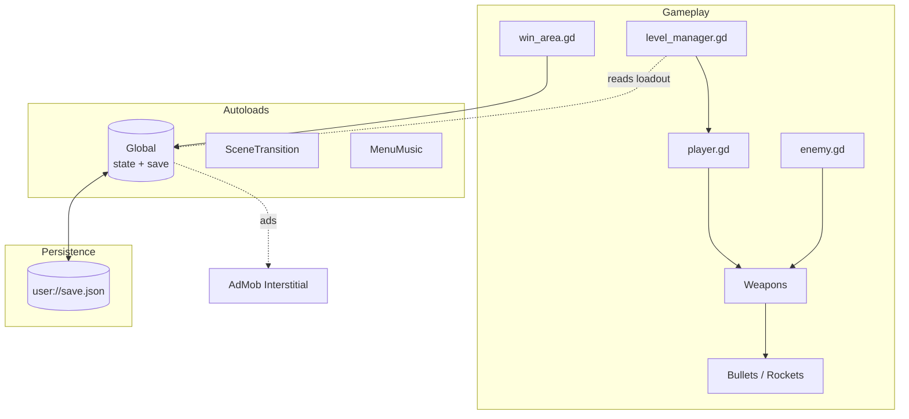
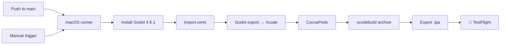

# 🎮 Escape From Kosova


**Escape From Kosova** is a 2D pixel-art side-scrolling action platformer built in [Godot 4](https://godotengine.org/) and published for iOS and Android. You play as a freedom fighter moving through eight levels set across Kosovo's towns, fighting enemy forces with a growing arsenal, using vehicles, and surviving hazards and bosses.

The game draws on the Kosovo War as its setting and mixes history-inspired atmosphere with arcade-style combat and platforming.

> **Live on Apple App Store and Google Play Store**

### At a Glance

| | |
|---|---|
| 🗺️ **Levels** | 8 (plus a tutorial) |
| 🔫 **Weapons** | 4 (Pistol, AK-47, Sniper, Rocket Launcher) |
| 🧑‍✈️ **Skills to upgrade** | 3 (Health, Speed, Jump), max level 7 each |
| 📜 **Game scripts** | 55 GDScript files, ~4,500 lines |
| 🎬 **Scenes** | 75 `.tscn` files |
| 🖼️ **Art assets** | 312 PNG images |
| 🔊 **Audio files** | 32 sound and music tracks |

---

## Table of Contents

- [Features](#features)
- [Gameplay](#gameplay)
- [Screens and Progression](#screens-and-progression)
- [Tech Stack](#tech-stack)
- [Architecture](#architecture)
- [Project Structure](#project-structure)
- [Getting Started](#getting-started)
- [Building and Releasing](#building-and-releasing)
- [CI/CD](#cicd)
- [Configuration and Save Data](#configuration-and-save-data)
- [Monetization](#monetization)
- [Development Notes](#development-notes)
- [Known Limitations](#known-limitations)
- [Credits](#credits)
- [License](#license)

---

## Features

- **Pixel-art Kosovo setting.** Levels are named after real towns, including Prizren, Ferizaj, Gjakove, Gjilan, Peja, Prishtina and Mitrovica, plus a tutorial level.
- **Combat with multiple weapons.** Start with a pistol and unlock an AK-47, a sniper rifle and a rocket launcher as you progress. Each weapon has its own magazine, reload behaviour and fire rate.
- **Enemy AI.** Enemies patrol, detect the player within an aggro radius, keep a preferred engagement distance, and fire on the player with their own weapons.
- **Vehicles and set-piece levels.** Some levels put the player in a helicopter or tank, with dedicated controllers and obstacles.
- **Bosses.** Named boss encounters include Arkan, Alexander, a helicopter and a tank.
- **Skill upgrades.** Spend in-game money to raise Health, Speed and Jump, up to a maximum level of 7 each.
- **Characters and outfits.** Several playable characters with their own faces and clothing sets, including a "Suit" and a "UQK" uniform.
- **Touch and keyboard/gamepad controls.** Works on mobile with on-screen touch buttons and on desktop with keyboard or gamepad input.
- **Persistent progress.** Unlocked levels, money, kills, upgrades and selected character are saved between sessions.

---

## Gameplay

| Action | Keyboard | Gamepad |
|---|---|---|
| Move left / right | A / D or ← / → | D-pad or left stick |
| Jump | Space | Button mapped to `Jump` |
| Aim / fire | Mouse | Mapped to `Fire` |
| Pause | Esc | Button mapped to `Pause` |

Mobile players use on-screen touch controls for movement, jumping and firing.

Mechanics worth knowing:

- **Coyote time and jump buffering** make platforming forgiving: you can still jump briefly after leaving a ledge, and a jump pressed slightly early will still register on landing.
- **Gravity** is heavier while falling than in a standard platformer, which gives jumps a snappier feel.
- **Level timers** count down per level. Each level has its own time limit, configured in one place (see below).
- **Money and kills** are tracked per run and in total. Money pays for skill upgrades.

---

## Screens and Progression



The game flows through these scenes:

1. **Opening cinematic**, then **main menu**.
2. **Character select**, **clothes select** and **gun select** to choose your fighter and loadout.
3. **Level select** on a world map. Levels unlock sequentially as you clear them.
4. **Level** gameplay with an HUD (health, ammo, money, timer) and a pause menu.
5. **Outcome screens:** win menu (with an interstitial ad on completion), death menu, and time-out menu.
6. **Skills** shop for spending earned money, **settings**, and **credits**.

Level configuration lives in `Global.gd` as a table keyed by level index. Each entry defines the level's numeric settings (including its time limit) and optionally the weapon unlocked on that level.

| Level | Location | Notes |
|---|---|---|
| 0 | Tutorial | First level |
| 1 | Prizren | Unlocks the AK-47 |
| 2 | Ferizaj | Unlocks the Sniper |
| 3 | Gjakove | |
| 4 | Gjilan | Unlocks the Rocket Launcher |
| 5 | Peja | |
| 6 | Prishtina | |
| 7 | Mitrovica | Final level |

### Level Time Limits

Time limits from the `level_stats` table in `Global.gd`:



### Weapon Unlock Path



### Skill Upgrade Costs

Each upgrade costs `50 × current level` money, up to level 7. Maxing one stat costs 1,050 money in total.



---

## Tech Stack



| Area | Technology |
|---|---|
| Engine | Godot 4.6 (GDScript) |
| Platforms | iOS, Android |
| Rendering | Godot 2D renderer, `canvas_items` stretch mode, 1920×1080 base resolution with expanding aspect ratio |
| Ads | [AdMob Plugin for Godot](https://github.com/poing-studios/godot-admob) v4.3.1 (Poing Studios) |
| CI/CD | GitHub Actions on macOS runners |
| iOS signing | Manual signing with an Apple Distribution certificate and provisioning profile |
| Android build | Gradle build, signed AAB, target SDK 36 |

---

## Architecture

The project is organized around Godot's scene-and-script model, with a few deliberate cross-cutting pieces.

### System Overview



### Autoloads (singletons)

Three nodes are registered as autoloads and are available everywhere:

- **`Global`** (`Scripts/global.gd`): owns all persistent game state (money, kills, unlocked levels, weapons, skills, settings). It serializes that state to JSON on save and restores it on launch. It also holds the level configuration table and initializes the ad SDK.
- **`SceneTransition`**: a shared scene that fades between screens.
- **`MenuMusic`**: a shared audio player so background music continues across menus and stops when a level starts.

### Gameplay scripts

- **`player.gd`** (`CharacterBody2D`): movement, jump with coyote time and jump buffering, health, ammo and weapon switching. The player is a skeletal 2D character driven by an `AnimationTree` and `Skeleton2D`, which lets animations blend between idle, run, jump and shoot.
- **`enemy.gd`**: a state-driven AI. Enemies patrol until the player enters their aggro distance, then hold a minimum distance and attack. Each enemy spawns a weapon scene chosen with an exported `PackedScene` property, which keeps enemy loadouts data-driven.
- **Weapons (`glock.gd`, `ak_47.gd`, `sniper.gd`, `rocket_launcher.gd`, `tank_barell.gd`)**: each weapon shares a similar interface for firing cooldowns, magazine capacity, reload time, recoil and camera shake. Projectiles are separate scenes (bullets, rockets, heli rockets).
- **Hazards and objects**: spikes, mines, explosive barrels, kill zones, falling and moving platforms, trampolines, and pickups (money, medkits, bullet cases).
- **Vehicles**: `helicopter.gd`, `heli_player.gd`, `tank.gd`, `tank_player.gd`, and `plane.gd`, each with its own controller.

### Level and flow management

- **`level_manager.gd`** runs on every level. It reads the selected character and clothing from `Global`, spawns the correct player variant (standard, helicopter or tank), positions it at the spawn point, and starts the level timer.
- **`win_area.gd`** triggers `Global.level_completed()`, which unlocks the next level and sets a flag the win menu reads.
- **`level_select.gd`** drives the map and reveals only the levels the player has unlocked.

### Persistence

Save data is a JSON file at `user://save.json` (on each platform's writable user directory). Only long-lived values are saved, not per-level state. Loading uses `.get()` with defaults, so older save files keep working when new fields are added.

### Input

Actions are defined in `project.godot` and bound to keyboard, mouse and gamepad inputs. Touch controls use `TouchScreenButton` nodes, with `touch_screen_button.gd` adding a small press animation.

---

## Project Structure

```
.
├── Assets/              # Art, audio, fonts, shaders and tilesets
│   ├── Audio/
│   ├── Characters/      # Player faces and clothing
│   ├── Enemies/
│   ├── Guns/
│   ├── Tiles/
│   ├── UI/              # Menus, HUD and map art
│   └── ...
├── Scenes/              # Godot scene files (.tscn)
│   ├── Levels/          # level_0 … level_7 and test levels
│   ├── Characters/      # Player, bosses, enemies, clothing
│   ├── Guns/
│   ├── Objects/         # Bullets, consumables, entities, dev helpers
│   └── Menus/           # Main menu, HUD, pause, shop, settings
├── Scripts/             # GDScript source
├── addons/admob/        # AdMob plugin
├── android/             # Android build configuration
├── ios/                 # iOS plugins and build configuration
├── .github/workflows/   # CI pipeline for iOS TestFlight
├── export_presets.cfg   # Android and iOS export presets
├── exportOptions.plist  # Xcode export options for App Store builds
└── project.godot        # Engine configuration, input map, autoloads
```

Each script in `Scripts/` usually has a matching `.uid` file. Godot generates these to keep references stable when files move. Commit them with the scripts.

---

## Getting Started

### Prerequisites

- **Godot 4.6.1** (standard edition is enough for development)
- **Export templates** for Godot 4.6.1, installed through the editor's *Manage Export Templates* dialog
- For iOS builds: a Mac with Xcode, CocoaPods, and Apple Developer credentials
- For Android builds: Android SDK and a JDK, plus a signing keystore

### Run the project

```bash
git clone https://github.com/DodaRoot/escapefromkosova.git
cd escapefromkosova
```

1. Open Godot 4.6.1 and choose **Import**, then select `project.godot`.
2. Let Godot finish importing assets on first launch. This creates the `.godot/` cache, which is git-ignored.
3. Press **F5** (Run Project). The game starts at the opening cinematic.

To jump straight to a specific scene, open it in the editor and press **F6**.

---

## Building and Releasing

Export presets are defined in `export_presets.cfg`.

### Android

- Preset: **Android**, using the Gradle build.
- Output: `.aab` (Android App Bundle) written one directory above the project, to `../EFK-ReleaseVersions/`.
- Package ID: `com.wardogs.escapefromkosova`.
- Target SDK: 36. Version code is tracked in the preset and incremented per release.

### iOS

- Preset: **iOS**, which exports an Xcode project.
- Output: an `.xcodeproj` that you archive with Xcode, or with the CI pipeline below.
- Bundle ID: `com.wardogs.escapefromkosova`.
- The project uses CocoaPods for Google Mobile Ads and the Google User Messaging Platform.

### Local export

From the editor, choose **Project → Export**, select the preset, and export. Or from the command line:

```bash
godot --headless --export-release "Android" ../EFK-ReleaseVersions/build.aab
godot --headless --export-release "iOS" ios-build/iOS.xcodeproj
```

---

## CI/CD



`.github/workflows/ios-testflight.yml` builds and uploads the iOS app to TestFlight. It runs on pushes to `main` and can be triggered manually. Each run:

1. Installs the pinned Godot editor and export templates, cached between runs. Downloads come from GitHub Releases, with tuxfamily as a fallback.
2. Imports the Apple distribution certificate and provisioning profile into a temporary keychain.
3. Runs a headless Godot import and iOS export.
4. Generates a `Podfile` for the ad SDKs and runs `pod install`.
5. Archives with `xcodebuild` using manual signing and exports a signed `.ipa`.
6. Uploads the `.ipa` as a workflow artifact (kept 14 days) and submits it to App Store Connect via `altool`.

The workflow needs these repository secrets:

| Secret | Purpose |
|---|---|
| `IOS_DIST_CERT_P12_BASE64` | Base64-encoded distribution certificate |
| `IOS_DIST_CERT_PASSWORD` | Password for the `.p12` |
| `IOS_PROVISION_PROFILE_BASE64` | Base64-encoded provisioning profile |
| `IOS_KEYCHAIN_PASSWORD` | Password for the temporary CI keychain |
| `IOS_TEAM_ID` | Apple Developer team ID |
| `APPLE_ID_EMAIL` | Apple ID used for upload |
| `APPLE_APP_SPECIFIC_PASSWORD` | App-specific password for upload |

---

## Configuration and Save Data

| Item | Location | Notes |
|---|---|---|
| Save file | `user://save.json` | Written by `Global.save_game()`, read on launch |
| Input bindings | `project.godot` `[input]` section | Edit in the Godot Input Map |
| Audio volumes | `Global` (master, music, SFX) | Applied to the `Master`, `Music` and `SFX` buses |
| Level tuning | `Scripts/global.gd` `level_stats` | Per-level numeric settings (including time limit) and weapon unlock |
| Dev mode | Settings menu | Shows the FPS counter and developer HUD |

Saved data includes money, kills, unlocked level, weapons, skill levels, characters, outfit, audio settings and tutorial flags. It does not include mid-level progress.

---

## Monetization

The game shows an **interstitial ad** after a level is won, using the AdMob plugin. Ad unit IDs are chosen per platform in `win_menu.gd`. The AdMob app ID is set in the export presets and in the iOS plugin configuration. Ads are not shown during gameplay.

---

## Development Notes

- **Code style.** GDScript with static-leaning typing where it helps, `@onready` for node references, and `@export` for tunable values in the editor. Constants for fixed tuning and `var` for runtime state.
- **Editing scenes.** Prefer the Godot editor to hand-editing `.tscn` files. Scene files are text, but their node and resource IDs are managed by the editor.
- **Adding a level.** Create `level_N.tscn` under `Scenes/Levels/`, add an entry to `level_scenes_container` and `level_stats` in `global.gd`, and add a button and handler in `level_select.gd`.
- **Adding a weapon.** Create a weapon scene under `Scenes/Guns/` using an existing one as a template, add its bullet scene, and register it in `Global.guns` and the player's weapon switching.
- **Adding a character.** Add face textures to the `FACES` dictionary in `player.gd` and a clothing scene under `Scenes/Characters/Clothing/`, then register them in `level_manager.gd`.
- **Temporary files.** Some `.tmp` files (for example, `level_1.tscn8566273886.tmp`) are editor backups. They should be removed and ignored in git.

---

## Credits

- **Game design, art and development:** Dode Doda
- **Engine:** [Godot Engine](https://godotengine.org/), MIT License.
- **Ads:** [AdMob Plugin for Godot](https://github.com/poing-studios/godot-admob) by Poing Studios.

Historical references to the Kosovo War are used for setting and atmosphere. The game is a work of fiction.

---

## License

All rights reserved by Dode Doda
